<div align="center">

# llm-ontology

**An evidence-grounded domain model compiler — and an interactive architecture tutorial.**

Turn messy, conflicting business sources into a typed, versioned, executable
**Canonical Ontology** that drives Agentic SaaS — and learn the whole design
through a hands-on course.

[](https://caizongyuan.github.io/llm-ontology/)
[](https://github.com/CaiZongyuan/llm-ontology/actions/workflows/site.yml)
[](https://vitepress.dev/)
[](./LICENSE)

**[Open the Interactive Tutorial](https://caizongyuan.github.io/llm-ontology/)** · [Why this exists](#why-this-exists) · [Curriculum](#tutorial-curriculum) · [Glossary](#core-vocabulary) · [Roadmap](#roadmap)

简体中文说明见 [**README.zh-CN.md**](./README.zh-CN.md)

</div>

---

## Why this exists

Ask an LLM agent to *"list beds stuck on delayed lab reports and schedule terminal cleaning"*
inside a hospital, and naive setups fail fast:

- **Text-to-SQL** breaks on semantics — the same *inpatient encounter* is `visit_no` in HIS,
  `inp_id` in EMR, and `encounter_id` in LIS; nobody agrees on how "discharge-ready time" is computed.
- **Pure RAG** can't tell *normative rules* from *observed violations* — it will happily
  recommend a workaround recorded in a night-shift handover note.
- **Unconstrained agent tools** bypass permissions, invariants, and auditability.

`llm-ontology` is the antidote: a compiler-inspired pipeline that treats business
knowledge like code — **discovered by LLMs, checked by a deterministic compiler,
released only after typed review**.

```mermaid
flowchart LR
    S["Sources<br/>SOPs · interviews · HIS/EMR/LIS snapshots"] --> F["Fragments<br/>citable evidence units"]
    F --> C["Claims<br/>normative · descriptive · observational · hypothetical"]
    C --> EG["Evidence Graph<br/>support & conflict links"]
    EG --> CAND["Candidate Ontology<br/>+ three-view previews"]
    CAND -- "Model ChangeSet" --> TC["Type & reference checks"]
    TC --> PA["Policy AST & state-machine invariants"]
    PA --> CAN["Canonical Ontology<br/>versioned · signed"]
    CAN --> GEN["Deterministic codegen<br/>schema · guards · UI · MCP tools · tests"]
    GEN --> OPS["Agentic SaaS runtime"]
    OPS --> WIKI["LLM Wiki<br/>experience pages"]
    WIKI -- "new evidence & change proposals" --> EG
```



Three ideas carry the whole design:

| Concept | What it means |
|---|---|
| **Two graphs** | The **Evidence Graph** keeps conflicting, uncertain claims with fragment-level provenance (ADR-0001); the **Canonical Ontology (Domain Graph)** only holds reconciled, typed, human-approved business contracts. |
| **Three loops** | **Discovery** (interviews → claims → ontology → SaaS tickets), **Operations** (events → guarded actions → event log), **Learning** (traces → LLM Wiki → change proposals) run concurrently, not as a waterfall. |
| **Two engines** | The **Semantic Discovery Engine** (LLM-driven, gets smarter with better models) proposes; the **Semantic Compiler Engine** (100% deterministic TypeScript — type checks, policy ASTs, state-machine invariants) disposes. LLMs never get the final say on production semantics. |

The running case study throughout is **hospital data governance & patient discharge
coordination** (inspired by the NHS Front Door Plus pattern), with side-by-side
readings of [NVIDIA/auto-ontology](https://github.com/NVIDIA/auto-ontology) (official
`Wide World Importers` sources), [Semantica](https://github.com/semantica-agi/semantica),
and [nashsu/llm_wiki](https://github.com/nashsu/llm_wiki).

## What's in this repository

| Path | Contents |
|---|---|
| [`site/`](https://caizongyuan.github.io/llm-ontology/) | **Interactive tutorial site** (VitePress + Vue 3) — a hands-on 0→1 journey, 17 lessons across 6 modules, and 18 interactive widgets (seven-act ontology compiler, evidence reconciliation lab, policy AST sandbox, projectional view switcher, prediction-driven labs, quiz, …). |
| [`GLOSSARY.md`](./GLOSSARY.md) | The domain language: 20+ rigorously defined terms with *avoid-lists* (e.g. don't confuse Evidence Graph with a knowledge graph). |
| [`docs/adr/`](./docs/adr/0001-separate-evidence-graph-canonical-ontology-and-llm-wiki.md) | Architecture decision records — starting with why Evidence Graph / Canonical Ontology / LLM Wiki must be three strictly separated layers. |
| `site/tools/subset_font.py` | Chinese font subsetting so the site ships a tiny woff2 (~display charset only). |

## Tutorial curriculum

> 🌐 **Read it live: <https://caizongyuan.github.io/llm-ontology/>**

| Module | Lessons |
|---|---|
| **00 · Hands-on: from zero to one** | [Compile a desk of messy sources into an Ontology](https://caizongyuan.github.io/llm-ontology/journey/) (seven-act interactive walkthrough with fullscreen mode) |
| **01 · Foundations: Ontology in the Agent era** | [One-page Ontology primer](https://caizongyuan.github.io/llm-ontology/ontology/) · [The eight-layer anatomy](https://caizongyuan.github.io/llm-ontology/ontology/anatomy) · [Hospital data governance & the Agentic Hospital](https://caizongyuan.github.io/llm-ontology/ontology/hospital-governance) |
| **02 · Open-source implementations** | [NVIDIA Auto-Ontology deep dive](https://caizongyuan.github.io/llm-ontology/opensource/auto-ontology) · [Semantica: auditable context graphs](https://caizongyuan.github.io/llm-ontology/opensource/semantica) |
| **03 · Knowledge consolidation: LLM Wiki** | [Karpathy's pattern: from RAG to continuous compilation](https://caizongyuan.github.io/llm-ontology/wiki/karpathy-pattern) · [nashsu/llm_wiki & bidirectional anchoring](https://caizongyuan.github.io/llm-ontology/wiki/nashsu-implementation) |
| **04 · Structured modeling: JetBrains MPS** | [Projectional editing: the model as the single source of truth](https://caizongyuan.github.io/llm-ontology/mps/projectional-editing) · [Three abstraction levels: meta-model, model, instance](https://caizongyuan.github.io/llm-ontology/mps/meta-modeling) |
| **05 · The blueprint: `llm-ontology` itself** | [Three loops & two engines](https://caizongyuan.github.io/llm-ontology/architecture/overview) · [Dual graphs: Evidence & Domain](https://caizongyuan.github.io/llm-ontology/architecture/dual-graphs) · [Meta-model primitives & typed policy ASTs](https://caizongyuan.github.io/llm-ontology/architecture/meta-model) · [Incremental compilation & runtime context resolution](https://caizongyuan.github.io/llm-ontology/architecture/compiler-and-runtime) · [MVP experiments & self-quiz](https://caizongyuan.github.io/llm-ontology/architecture/mvp-and-quiz) |
| **06 · Controlled landing: run the architecture** | [What does a rule change actually touch?](https://caizongyuan.github.io/llm-ontology/practice/change-set) · [Who lets an Agent actually release a bed?](https://caizongyuan.github.io/llm-ontology/practice/action-guard) · [How do we know it isn't a demo animation?](https://caizongyuan.github.io/llm-ontology/practice/golden-cases) |

## Core vocabulary

The full glossary lives in [`GLOSSARY.md`](./GLOSSARY.md) (中文). A taste:

| Term | 中文 | In one line |
|---|---|---|
| **Claim** | 事实主张 | A business assertion extracted from evidence, carrying a modality (`normative` / `descriptive` / `observational` / `hypothetical`) and a scope; duplicates and conflicts are allowed *before* reconciliation. |
| **Evidence Graph** | 证据图 | The provenance network recording *why we believe* each claim — never confuse it with a RAG index or a knowledge graph. |
| **Concept Registry** | 概念注册表 | Stable concept identity across sources: HIS `visit_no` ≡ EMR `inp_id` ≡ LIS `encounter_id`, with alias-linking kept strictly separate from concept merging. |
| **Canonical Ontology** | 权威本体 | The versioned, single normative source of truth for concepts, relations, state machines, actions, and policies. |
| **Policy** | 策略约束 | Typed-AST guard rules enforced deterministically *before* any action executes — never delegated to the LLM's judgment. |
| **Model ChangeSet** | 模型变更集 | The *only* legal way to modify the Canonical Ontology: a structured diff bound to claim IDs, affected nodes, and a version baseline. |
| **Ontology Context Package** | 本体上下文包 | The minimal, task- and role-scoped context + available-action set resolved for an agent at runtime — not a "paste the whole ontology" prompt. |

## Roadmap

The design is complete and the compiler implementation is planned as three
cumulative experiments (detailed in [Module 05](https://caizongyuan.github.io/llm-ontology/architecture/mvp-and-quiz)):

- [ ] **Experiment A — `Raw → Ontology`**: ingest conflicting hospital SOP/interview/log sources; produce a reconciled Candidate Ontology with a full evidence chain.
- [ ] **Experiment B — `Ontology → SaaS`**: compile the signed ontology into a minimal guarded app (TypeScript + Hono + PostgreSQL/SQLite + React/Vue; JSONB + FTS + pgvector + recursive CTEs instead of a dedicated graph DB).
- [ ] **Experiment C — `Change → Recompile`**: submit a `Model ChangeSet`, watch incremental recompilation regenerate only affected schema / guards / UI / MCP tools / tests.

Stack guidance for v1 lives in the [MVP lesson](https://caizongyuan.github.io/llm-ontology/architecture/mvp-and-quiz).

## Local development

The site is a VitePress app; deploys to GitHub Pages run automatically on
pushes to `main` (`.github/workflows/site.yml`).

```bash
pnpm install --dir site     # install once
pnpm --dir site dev         # dev server at http://127.0.0.1:5294
pnpm --dir site build       # production build (also verifies font coverage)
```

If you edit Chinese site copy, regenerate the subset display font first:

```bash
pnpm --dir site font        # re-subset noto-serif-sc-600.woff2 to the used charset
pnpm --dir site build       # then verify
```

## Related work

- [NVIDIA/auto-ontology](https://github.com/NVIDIA/auto-ontology) — NVIDIA's ontology extraction pipeline; analyzed with its official `Wide World Importers` sources.
- [semantica-agi/semantica](https://github.com/semantica-agi/semantica) — auditable context graphs for agents.
- [nashsu/llm_wiki](https://github.com/nashsu/llm_wiki) — the LLM-maintained wiki pattern, bidirectionally anchored to the ontology here.
- [JetBrains MPS](https://www.jetbrains.com/mps/) — projectional editing and meta-modeling philosophy behind the multi-view model studio.

## License

Released under the [MIT License](./LICENSE).
