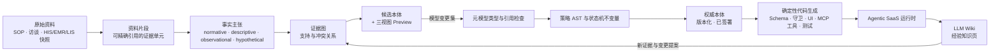

<div align="center">

# llm-ontology

**证据驱动的领域模型编译器 —— 以及一套交互式架构教程。**

把杂乱、互相冲突的业务原始资料，编译为类型安全、可版本化、可执行的
**权威本体（Canonical Ontology）**，驱动 Agentic SaaS 的构建、运行与演化；
并通过一门动手课程讲透整个设计。

[](https://caizongyuan.github.io/llm-ontology/)
[](https://github.com/CaiZongyuan/llm-ontology/actions/workflows/site.yml)
[](https://vitepress.dev/)
[](./LICENSE)

**[进入交互式教程](https://caizongyuan.github.io/llm-ontology/)** · [为什么需要它](#为什么需要它) · [课程目录](#课程目录) · [核心术语](#核心术语) · [路线图](#路线图)

English documentation: [**README.md**](./README.md)

</div>

---

## 为什么需要它

让 AI Agent 在医院里「列出被检验报告延迟卡住的床位，并通知后勤安排终末消毒」，
天真的接法会立刻撞墙：

- **Text-to-SQL 败在语义**：同一个「住院就诊」，在 HIS 里叫 `visit_no`，在 EMR 里叫
  `inp_id`，在 LIS 里叫 `encounter_id`；「出院准备时长」从哪个时间点起算，谁也说不拢。
- **纯 RAG 分不清规范与违规**：它会把夜班交班记录里的违规操作习惯，当成合法规则推荐给你。
- **无约束的 Agent 工具**会绕过权限校验、状态机不变量与审计链路。

`llm-ontology` 是解药：一条编译器式的流水线，把业务知识当代码对待 ——
**由 LLM 归纳发现，由确定性编译器铁面校验，经类型化人工审查后才能发布**。



三个核心概念撑起整个设计：

| 概念 | 含义 |
|---|---|
| **双图架构** | **证据图（Evidence Graph）** 保留互相冲突、不确定的事实主张及片段级溯源（ADR-0001）；**权威本体（Domain Graph）** 只保存消解后、强类型、经人工批准的业务契约。 |
| **三个闭环** | **需求发现闭环**（访谈 → 主张 → 本体 → 开发任务）、**业务运行闭环**（事件 → 守卫动作 → 事件日志）、**学习演化闭环**（Trace → LLM Wiki → 变更提案）并行交织，而非瀑布流。 |
| **两大引擎** | **语义发现引擎**（LLM 驱动，随模型升级变强）负责提议；**语义编译引擎**（100% 确定性 TypeScript：类型检查、策略 AST、状态机不变量）负责裁决。生产语义永远不由 LLM 拍板。 |

贯穿案例是**智慧医院数据治理与患者出院协同**（NHS FDP 范式），并对照精读
[NVIDIA/auto-ontology](https://github.com/NVIDIA/auto-ontology)（官方 `Wide World Importers`
源码）、[Semantica](https://github.com/semantica-agi/semantica) 与
[nashsu/llm_wiki](https://github.com/nashsu/llm_wiki)。

## 仓库里有什么

| 路径 | 内容 |
|---|---|
| [`site/`](https://caizongyuan.github.io/llm-ontology/) | **交互式教程站点**（VitePress + Vue 3）—— 5 个模块 14 讲，内嵌 11 个交互组件（证据消解实验室、策略 AST 沙盘、投影视图切换器、综合自测等）。 |
| [`GLOSSARY.md`](./GLOSSARY.md) | 领域语言：20+ 个严格定义的术语，附 *Avoid 清单*（例如：别把证据图当知识图谱）。 |
| [`docs/adr/`](./docs/adr/0001-separate-evidence-graph-canonical-ontology-and-llm-wiki.md) | 架构决策记录 —— 从「证据图 / 权威本体 / LLM Wiki 为何必须三层严格隔离」开始。 |
| `site/tools/subset_font.py` | 中文字体子集化脚本，让站点只携带展示字符集的微型 woff2。 |

## 课程目录

> 🌐 **在线阅读：<https://caizongyuan.github.io/llm-ontology/>**

| 模块 | 课程 |
|---|---|
| **01 · 认知基石：什么是 Ontology** | [一页看懂 Agent 时代的 Ontology](https://caizongyuan.github.io/llm-ontology/ontology/) · [Ontology 的八层解剖](https://caizongyuan.github.io/llm-ontology/ontology/anatomy) · [医院数据治理与 Agentic Hospital](https://caizongyuan.github.io/llm-ontology/ontology/hospital-governance) |
| **02 · 开源实现：从语义层到可审计图谱** | [NVIDIA Auto-Ontology 深度剖析](https://caizongyuan.github.io/llm-ontology/opensource/auto-ontology) · [Semantica：可审计 Context Graph](https://caizongyuan.github.io/llm-ontology/opensource/semantica) |
| **03 · 知识沉淀范式：LLM Wiki** | [Karpathy 模式：从 RAG 到持续编译](https://caizongyuan.github.io/llm-ontology/wiki/karpathy-pattern) · [nashsu/llm_wiki 与本体双向锚定](https://caizongyuan.github.io/llm-ontology/wiki/nashsu-implementation) |
| **04 · 结构化建模哲学：JetBrains MPS** | [投影式编辑：模型才是唯一事实源](https://caizongyuan.github.io/llm-ontology/mps/projectional-editing) · [三层抽象阶梯：元模型、领域模型与实例](https://caizongyuan.github.io/llm-ontology/mps/meta-modeling) |
| **05 · 终极架构：`llm-ontology` 本体设计** | [三个闭环与两大引擎](https://caizongyuan.github.io/llm-ontology/architecture/overview) · [双图架构：Evidence Graph 与 Domain Graph](https://caizongyuan.github.io/llm-ontology/architecture/dual-graphs) · [Meta-model 原语与类型化策略 AST](https://caizongyuan.github.io/llm-ontology/architecture/meta-model) · [增量语义编译与运行时上下文解析](https://caizongyuan.github.io/llm-ontology/architecture/compiler-and-runtime) · [最小验证实验与综合自测](https://caizongyuan.github.io/llm-ontology/architecture/mvp-and-quiz) |

## 核心术语

完整术语表见 [`GLOSSARY.md`](./GLOSSARY.md)。预览几个：

| 术语 | 一句话定义 |
|---|---|
| **事实主张（Claim）** | 从证据中提取的业务断言，携带模态（`normative` / `descriptive` / `observational` / `hypothetical`）与适用范围；消解前允许重复与冲突。 |
| **证据图（Evidence Graph）** | 记录「我们为什么相信某个业务主张」的溯源网络 —— 别把它和知识图谱或 RAG 索引混为一谈。 |
| **概念注册表（Concept Registry）** | 跨源概念身份管理：HIS 的 `visit_no` ≡ EMR 的 `inp_id` ≡ LIS 的 `encounter_id`，并严格区分「同义词关联」与「概念合并」。 |
| **权威本体（Canonical Ontology）** | 业务概念、关系、状态机、动作与策略的唯一规范性事实源，版本化、经签署发布。 |
| **策略约束（Policy）** | 以类型化 AST 表达的守卫规则，在动作执行前由确定性执行层强制校验 —— 绝不交给 LLM 自行判断。 |
| **模型变更集（Model ChangeSet）** | 修改权威本体的*唯一*合法途径：绑定主张 ID、受影响节点与版本基线的结构化增量提案。 |
| **本体上下文包（Ontology Context Package）** | 运行时按任务与角色解析出的最小上下文与可用动作集合 —— 而不是「把整个本体塞进提示词」。 |

## 路线图

架构设计已完成，编译器实现规划为三个递进实验（详见
[模块 05](https://caizongyuan.github.io/llm-ontology/architecture/mvp-and-quiz)）：

- [ ] **实验 A —— `Raw → Ontology`**：摄入互相冲突的医院规章 / 访谈 / 日志，产出带完整证据链的候选本体。
- [ ] **实验 B —— `Ontology → SaaS`**：将签署后的本体编译为最小守卫式应用（TypeScript + Hono + PostgreSQL/SQLite + React/Vue；用 JSONB + FTS + pgvector + 递归 CTE 替代专用图数据库）。
- [ ] **实验 C —— `Change → Recompile`**：提交一个 `Model ChangeSet`，观察增量重编译只重新生成受影响的 Schema / 守卫 / UI / MCP 工具 / 测试。

v1 技术选型指引见 [MVP 一课](https://caizongyuan.github.io/llm-ontology/architecture/mvp-and-quiz)。

## 本地开发

站点基于 VitePress；推送到 `main` 分支后由 `.github/workflows/site.yml`
自动构建并发布到 GitHub Pages。

```bash
pnpm install --dir site     # 首次安装
pnpm --dir site dev         # 开发服务器 http://127.0.0.1:5294
pnpm --dir site build       # 生产构建（同时校验字体覆盖）
```

修改站点中文文案后，请先重新生成子集化字体：

```bash
pnpm --dir site font        # 按实际用字重新子集化 noto-serif-sc-600.woff2
pnpm --dir site build       # 再验证构建
```

## 相关项目

- [NVIDIA/auto-ontology](https://github.com/NVIDIA/auto-ontology) —— NVIDIA 的本体抽取流水线；保留官方 `Wide World Importers` 源码对照。
- [semantica-agi/semantica](https://github.com/semantica-agi/semantica) —— 面向 Agent 的可审计 Context Graph。
- [nashsu/llm_wiki](https://github.com/nashsu/llm_wiki) —— LLM 维护的 Wiki 模式；本项目将其与本体双向锚定。
- [JetBrains MPS](https://www.jetbrains.com/mps/) —— 多视图模型工作台背后的投影式编辑与元建模哲学。

## 许可证

基于 [MIT License](./LICENSE) 发布。
