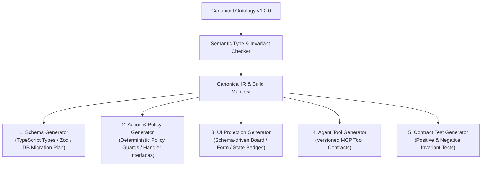

# 增量语义编译与运行时上下文解析

当一份 `Canonical Ontology` 发布之后，它绝不能只是一份躺在仓库里供人瞻仰的静态 JSON 文档。它必须立刻干两件大事：
1. **在构建期（Build Time）**：通过 **Model Compiler（模型编译器）** 生成或更新前后端数据结构、确定性权限守卫、UI 视图、Agent 工具定义与契约测试；并在后续需求演进时，通过 **Incremental Semantic Compiler（增量语义编译器）** 实现局部精准重编译。
2. **在运行期（Run Time）**：通过 **Ontology Context Resolver（本体上下文解析器）**，根据当前患者的实时状态动态装配最小 `Ontology Context Package` 喂给 Agent Harness。

::: tip 读完这一页你应该能回答
- **Model Compiler** 输出哪 7 类软件工件？为什么我们坚持“**Schema 驱动通用部分 + 契约约束定制代码**”而不是追求虚幻的“100% 全量代码生成”？
- 当医院有 10,000 份资料、几百个本体节点，今天只修改了一条日间手术审批 SOP 时，**Incremental Semantic Compiler** 如何利用 `Dependency Graph` 和 `Build Manifest` 只重编译受影响的下游节点？
- 运行时 `Ontology Context Resolver` 是如何按 $\text{Task} + \text{Runtime State} + \text{Ontology} \rightarrow \text{Relevant Context}$ 公式动态裁剪上下文的？
:::

## 一、Model Compiler：稳定的 Canonical IR + 插件化多目标生成器

借鉴 LLVM 与现代编译器的设计，`llm-ontology` 将通过验证的权威本体转化为统一的 **Canonical IR（规范中间表示）**，再挂载多个独立的生成器插件（Generator Plugins）：



### 务实的工程边界：为什么不追求“100% 代码自动生成”？

很多模型驱动开发（MDD）项目之所以失败，是因为试图用模型生成每一行像素级动画和复杂调度算法。我们的策略非常清晰：

| 编译目标产物 | 生成与执行策略 | 原因说明 |
|---|---|---|
| **1. 数据类型与校验 (`schema.zod.ts`)** | **100% 自动编译生成** | 保证数据库、后端 API、前端表单与 Agent 输入共享完全一致的字段类型与枚举 |
| **2. 权限与状态守卫 (`policy-guards.ts`)** | **100% 由 Policy AST 编译生成** | 安全与合规底线绝不允许手写绕过或交给 LLM 自由发挥 |
| **3. Agent 工具契约 (`mcp-tools.json`)** | **100% 自动编译生成** | 工具名、参数 Schema、前置条件说明直接从 `Action` 节点导出 |
| **4. 常规业务界面 (`discharge-board.vue`)** | **Schema 驱动运行时 + 扩展插槽** | 列表、状态流转按钮、表单校验自动生成；复杂的床位甘特图交互允许挂载定制组件 |
| **5. 复杂业务动作实现 (`Action Handler`)** | **编译器生成强类型接口契约，Coding Agent 实现内部集成逻辑** | 例如调用医院老旧 HIS 的 HL7 v2 消息接口，由 Coding Agent 在生成的接口契约与测试保护下编写 |

---

## 二、Incremental Semantic Compiler：局部变更如何精准传播？

假设医院系统已经稳定运行半年，积累了上千份规章与数百个本体节点。今天医务科更新了一份《日间手术绿色通道补充规定》的第 2 页，把“眼科日间病房”也纳入了主治医师单签放行范围。

如果每次改一句话都要让 Agent 重新读完上千份文档、重新生成整个 Ontology、重新编译全部前后端代码，系统在工程上根本无法实用。

为此，我们维护了一张横跨 **证据 → 本体 → 编译产物** 的工程依赖图（**Artifact Dependency Graph**），并在每次编译时输出一份带哈希签名的 **`Build Manifest`**：

```json
{
  "manifestVersion": "1.0",
  "ontologyVersion": "1.2.1",
  "artifacts": {
    "generated/policy-guards.ts": {
      "generatorVersion": "0.4.0",
      "dependsOnNodes": [
        "hospital.policy.discharge_signoff",
        "hospital.action.confirm_medically_fit"
      ],
      "inputNodesHash": "sha256:9f82c1...",
      "artifactHash": "sha256:4b10e8..."
    }
  }
}
```

### 增量编译的六步流水线

1. **Source Diff（源级差分）**：对比新旧 SOP 文档的段落结构与 SHA-256，仅定位发生变化的 `Fragment`（如 `frag_daysurg2026_p2`）；
2. **Local Claim Extraction（局部主张重提）**：仅针对变更片段重新提取或更新关联的 `Claim-09`；
3. **Node Impact Resolution（本体节点影响分析）**：顺着溯源边找到绑定 `Claim-09` 的 `hospital.policy.discharge_signoff` 节点，生成最小 `Model ChangeSet`；
4. **Artifact Dependency Walk（下游产物遍历）**：查询 `Build Manifest`，找出 `dependsOnNodes` 包含该策略节点的 4 个下游产物（守卫代码、关联 Action 契约、前端签字组件、策略测试），其余 24 个无关产物直接复用缓存；
5. **Destructive Change Protection（破坏性变更保护门）**：如果某个变更试图删除已有属性或缩窄字段类型，编译器立即触发 `BLOCKED` 保护门，要求先提供数据库迁移与历史兼容方案；
6. **Targeted Regression（定向回归测试）**：仅运行受影响子图的正负例契约测试，全绿后完成秒级热发布。

---

## 三、交互沙盒：亲手触发三类上游变更，观察依赖图传播

点击下方增量编译器沙盒中的 **场景 A（局部 SOP 规则扩展）**、**场景 B（仅修改概念中文显示名称）** 与 **场景 C（试图删除核心属性的高危变更）**，观察依赖图中哪些节点被点亮重算、哪些保持缓存复用、哪些触发破坏性保护门：

<IncrementalImpactGraph />

---

## 四、运行时闭环：`Ontology Context Resolver` 动态装配机制

当系统投入日常使用后，Ontology 不再只是编译期的图纸，而是实时参与每一次 Agent 推理的导航仪。

假设心内科护士站触发事件：“*检查 `Encounter-2026-089`（张某）今天能否按时在 14:00 前释放 302 床*”。

传统的做法是把全医院所有规章制度和几十个 MCP 工具一股脑塞进 Agent 的 System Prompt，既浪费 Token 又容易引发工具误调。而在 `llm-ontology` 中，**`Ontology Context Resolver`** 执行如下确定性公式：

$$\text{Task (出院协同)} + \text{Runtime State (Encounter-089 = DischargeTasksPending)} + \text{Canonical Ontology v1.2} \longrightarrow \text{Ontology Context Package}$$

解析出的最小 **`Ontology Context Package`** 仅包含当前状态真正需要的信息：

```text
Ontology Context Package [Encounter-2026-089]
├── 1. Focused Entities & State
│   ├── Encounter-2026-089 (status: DischargeTasksPending, medicallyFit: true)
│   └── Bed-302 (ward: Cardiology-3F, cleaningStatus: Occupied)
├── 2. Active Invariants & Policies
│   └── inv.zero_critical_labs (PASS: pending_critical_labs == 0)
├── 3. State-Filtered Available Actions (仅开放当前状态合法的动作！)
│   ├── hospital.action.expedite_pending_imaging (可用：超声未出)
│   ├── hospital.action.pre_audit_meds (可用：带药未核对)
│   └── [已隐藏/禁用] hospital.action.release_bed (原因：前置任务未清零)
└── 4. Anchored LLM Wiki Pages (通过稳定 ID 精准拉取)
    └── [[wiki.cardio_friday_discharge_delay]] (提示周五药房核对高峰应对策略)
```

::: danger 运行时安全的最后一道铁闸
虽然 `Ontology Context Resolver` 已经按当前状态与用户角色过滤了暴露给 Agent 的候选 `Action` 列表，但这**仅仅是能力发现与上下文优化**。当 Agent 真正发起 `Action` 调用时，后端的 **`Deterministic Action Executor` 必须使用真实会话身份再次独立执行完整的 Policy AST 与状态机前置条件校验**，绝不信任大模型端传来的任何权限自述！
:::

## 下一课预告

到这里，你已经掌握了 `llm-ontology` 内部架构的全部核心机密。最后一课，我们将给出 **`llm-ontology` 仓库的轻量级代码包结构、三个递进式最小验证实验（MVP Experiments）的验收标准**，并通过 **12 道综合交互自测题** 检验你的掌握程度！请看 **[最小验证实验（MVP）与综合自测](/architecture/mvp-and-quiz)**。
