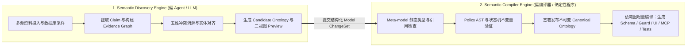

# 三个闭环与两大引擎总览

经过前四个模块的铺垫，我们现在可以把 **NVIDIA Auto-Ontology**、**Semantica**、**Karpathy LLM Wiki** 与 **JetBrains MPS** 凝聚为本项目 **`llm-ontology`** 的核心架构定义：

> **`llm-ontology` 是一个由 Agent 驱动、以证据为根基的领域模型编译器（Evidence-Grounded Domain Model Compiler）。**
> 它从杂乱、存在噪声和冲突的原始资料（SOP、访谈、异构数据库）中提取可追溯主张，将其编译为类型安全、可版本化、可执行的 **Canonical Ontology**，并持续驱动 Agentic SaaS 的生成、业务运行与自我演化。

::: tip 读完这一页你应该能回答
- 什么是 **需求闭环（Discovery Loop）**、**运行闭环（Operations Loop）** 与 **学习闭环（Learning Loop）**？为什么它们不是瀑布流而是并行交织的？
- 当客户（如医院主任）不可能 24 小时随叫随到时，Agent 如何通过 **感知不确定性的需求发现（Uncertainty-aware Discovery）** 与 **Decision Inbox** 持续推进开发？
- 为什么必须将系统拆分为 **Semantic Discovery Engine（偏 LLM 归纳）** 与 **Semantic Compiler Engine（偏确定性校验与生成）** 两大引擎？
- 从认知科学角度，系统的六个部分如何对应人类的六种记忆与认知功能？
:::

## 一、三大闭环：从需求对齐，到业务运行，再到持续学习

整套系统的全生命周期可以浓缩为一条六个节点的价值链：

$$\text{Evidence (证据)} \longrightarrow \text{Ontology (本体)} \longrightarrow \text{Software (软件)} \longrightarrow \text{Operations (运行)} \longrightarrow \text{Learning (知识)} \longrightarrow \text{Evolution (演化)}$$

它由三个相互咬合的闭环组成：

| 闭环名称 | 核心流转过程 | 持续沉淀的核心资产 | 权威事实源 (Source of Truth) |
|---|---|---|---|
| **1. 需求与建模闭环 (Discovery Loop)** | 访谈 / 资料 / 异构库 → 提取 `Claim` → 冲突消解 → 三视图 Preview 确认 → 发布 `Canonical Ontology` → 编译生成 SaaS 与 Tickets | 可追溯的业务证据链、版本化权威本体、纵向切片开发任务 | **Canonical Business Model**（业务语义、规则与契约的唯一权威） |
| **2. 业务运行闭环 (Operations Loop)** | 业务事件 / 请求 → `Context Resolver` 按需装载上下文 → Agent 推理提议 → `Action Executor` 确定性守卫校验 → 更新业务状态并记录事件 | 真实住院/业务实例、状态迁移、领域事件流（`Domain Event`）与 PROV-O 审计链 | **System of Record & Event Log**（真实业务状态与历史记录的唯一权威） |
| **3. 学习与演化闭环 (Learning Loop)** | 运行事件与 Trace → `LLM Wiki` 增量综合与 Lint → 提炼经验页 / Skill 优化 / `Model ChangeSet` → 触发局部增量重编译 | 双向锚定的经验知识页（`Wiki Page`）、自动化评测集、下一版模型变更提案 | **Source Corpus & LLM Wiki**（证据、经验解释与复盘的权威来源） |

<LoopStageFlow :initial="0" />

---

## 二、深入需求闭环：感知不确定性的 Grilling 与三重 Preview

在传统软件开发中，Matt Pocock 的 `grill-with-docs` 倾向于把所有未知决策逐轮追问清楚后再写代码。但在医院或企业 SaaS 交付中，**客户专家不可能每天 24 小时在线随叫随到**。

因此，`llm-ontology` 引入了 **Uncertainty-aware Discovery（感知不确定性的异步需求发现机制）**：Agent 根据证据充分度与决策风险等级，将业务主张分为五类分别处理，无需阻塞整个工程进度：

| 需求主张与证据状态 | 典型医院出院协同示例 | Agent 的自主推进策略 |
|---|---|---|
| **1. 证据明确且无冲突** | 住院就诊必须包含主索引号、床位号、入院时间 | **直接入模**：生成候选 `EntityType` 与字段映射，先行推进基础模块开发 |
| **2. 多源一致但未经人工签字** | HIS 与 EMR 均显示出院小结须在离院前 24h 内完成归档 | **标记高可信候选**：纳入 Preview 看板，继续交叉验证 |
| **3. 存在局部冲突但不阻塞主流程** | 不同科室对“出院随访短信发送时间”是上午 9 点还是 10 点描述不一 | **记录假设并推进**：采用安全默认值，放入非阻塞确认列表 |
| **4. 涉及医疗安全、角色权限或不可逆变更** | 日间手术是否允许主治医师跳过科主任单签直接释放床位？ | **强制阻塞（GATE BLOCKED）**：生成高优 `Decision Request` 放入 **Decision Inbox**，未获授权前严禁编译上线该规则 |
| **5. 纯 UI 布局或文案偏好** | 床位看板按“病区房号”还是按“预计出院紧迫度”默认排序 | **生成可切换默认方案**：在 UI Preview 中提供开关供客户随时调整 |

### Preview 即证据采集器（Preview as Evidence Gathering）

Agent 不会甩给医院一份几万字没人看的文字 PRD，而是从同一个候选模型投射出 **三重交互式 Preview**：
1. **业务逻辑 Preview**：让医务科确认“系统是否真正理解了本院的出院路径与审批规则”；
2. **UI / UX Preview**：让护士长与住院总确认“日常床位协同看板与提醒交互是否顺手”；
3. **MVP 范围 Preview**：让院方确认“第一阶段先交付哪些纵向切片（Tracer-bullet Vertical Slices）”。

更关键的是：**当客户在 Preview 界面上点击修改一条流程或勾选一个权限选项时，这次交互本身就被自动记录为一条新的、带签名的 `Decision Evidence`，反向注入 `Evidence Graph`！**

---

## 三、两大核心引擎：LLM 负责归纳提议，编译器负责铁面校验

为了彻底杜绝“大模型幻觉直接污染生产软件”，`llm-ontology` 在内部架构上严格切分为两个核心引擎，中间仅通过结构化的 **`Candidate Ontology`** 与 **`Model ChangeSet`** 通信：

- **Semantic Discovery Engine（语义发现引擎）**：充分发挥大模型在阅读非结构化 PDF、听懂访谈录音、对齐异构表同义词、归纳异常复盘（LLM Wiki）上的灵活性。随着底层大模型升级，它的发现能力会越来越强。
- **Semantic Compiler Engine（语义编译引擎）**：**100% 由确定性 TypeScript 代码实现，绝不让 LLM 充当裁判。** 它像 Rust 或 TypeScript 编译器一样，对节点 ID、引用完整性、策略 AST 类型匹配、状态机可达性进行铁面无私的检查，并确定性地生成下游代码与运行时守卫。

---

## 四、用认知科学的六维记忆模型记住整套架构

为了避免把“Agent Memory”粗暴理解成一个无所不包的向量数据库，你可以用人类认知系统的功能分工来对应 `llm-ontology` 的各个子系统：

| 人类认知功能 | 在 `llm-ontology` 架构中的对应子系统 | 生命周期与可靠性特征 |
|---|---|---|
| **语义记忆（Semantic Memory）**：知道什么是患者、床位、出院路径及它们的关系 | **Canonical Ontology (Domain Graph)** | 慢速演进、强类型、经严格审批的规范性事实源 |
| **工作记忆（Working Memory）**：知道当前正在处理哪位患者的哪项任务 | **`Ontology Context Package` + Runtime State** | 按任务实时动态装配、随会话结束释放 |
| **情景记忆（Episodic Memory）**：记得某年某月某次出院究竟发生了什么 | **Domain Event Log + Agent Trace (PROV-O)** | 只追加（Append-only）、不可篡改、精确到时间戳与模型版本 |
| **程序性记忆（Procedural Memory）**：知道如何一步步完成催检与排程消毒 | **Kinetic Actions + Workflows + Agent Skills** | 经过正负例契约测试验证的可执行操作规程 |
| **知识整合（Memory Consolidation）**：在睡眠/复盘时从经历中提炼规律 | **LLM Wiki (`Ingest / Synthesis / Lint`)** | 持续增量编译、双向锚定本体 ID 的经验网络 |
| **元认知与纠错（Metacognition）**：发现原有认识有误并修正规则 | **Evidence Graph + `Model ChangeSet` 演化流水线** | 证据驱动、影响分析前置、支持安全回滚 |

## 下一课预告

明确了两大引擎与三个闭环的宏观分工后，我们马上深入第一个核心技术难点：**当医院提供的 4 份规章、访谈和历史日志互相打架时，`Evidence Graph` 究竟如何保存这些不确定信息，并通过五维消解将其转化为干净的 `Domain Graph`？** 请看下一课：**[双图架构：Evidence Graph 与 Domain Graph](/architecture/dual-graphs)**。
