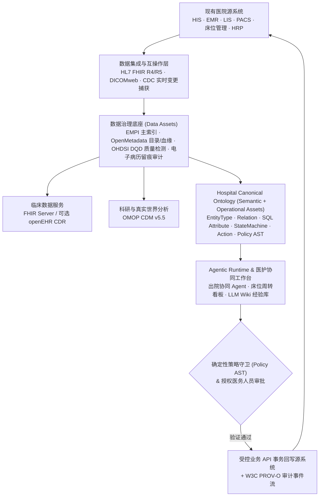

# 医院数据治理与 Agentic Hospital 参考框架

**医院数据治理的终点，绝不应该是建一个孤立的数据中台、数据仓库或者挂在院长办公室墙上的 BI 大屏，而应该是让医院形成「数据 → 语义 → 决策 → 行动 → 反馈」的业务闭环，迈向 Agentic Hospital（智能体驱动的医院）。**

这一课我们将国内医院验收合规标准、国际医疗互操作技术规范，以及全球最成熟的医院本体运营标杆（英国 NHS Federated Data Platform）整合为一套可直接指导 `llm-ontology` 落地的参考框架。

::: tip 读完这一页你应该能回答
- 全球医疗领域最值得深入拆解的 Ontology 落地案例（**NHS FDP + Palantir Foundry**）是怎么设计的？为什么 NHS 要坚持自己持有 CDM 本体知识产权？
- 国内医院数据治理必须对齐哪 **四份核心文件**（含 2026 年 7 月实施的 **DCMM GB/T 36073-2025** 与卫健委 2025《人工智能+医疗卫生》实施意见）？
- **FHIR**、**openEHR**、**OMOP CDM**、**DICOM**、**OpenMetadata** 与 **Hospital Ontology** 各自解决什么问题？为什么绝不能用 OMOP 直接驱动医嘱开立？
- 医院数据治理的 **三类核心资产（Data / Semantic / Operational Assets）** 如何分层协同？
:::

## 一、全球头号标杆案例：英国 NHS FDP 与医院本体知识产权

如果要选一个最贴近未来 Agentic Hospital 的真实生产级系统，首选不是某家医院单独定制的 HIS，而是英国国家医疗服务体系建设的 **NHS Federated Data Platform（NHS FDP，联邦数据平台）** 及其核心应用 **OPTICA（住院与出院流转协同工作台）**。

### 1. 不替代原有 HIS/EMR，而是在其上构建业务本体协同层

NHS FDP 的核心设计非常务实：它不去推翻各家医院原有的电子病历（EPR/EMR）和实验室系统，而是通过统一的数据连接与 **Canonical Data Model（标准数据模型与业务本体）**，把分散在床位管理、排班、检验、影像、行政审批中的数据对齐为可操作的业务对象（`Patient`、`Encounter`、`Bed`、`TheatreSession`、`DischargeTask`）。

在已披露的实际医院运营报告中：
- **Chesterfield Royal Hospital**：引入平台优化手术室排程与患者流转后，2024 年 4–12 月同比增加 **+232 例** 手术患者；
- **Coventry & Warwickshire**：采用 NHS FDP 后报告排程病例数量提升 **+25%**；
- **OPTICA 出院协同模块**：实时追踪每位住院患者的出院准备阻塞点（待开带药、待出检查、待社区接收），将行政协调平均滞留时长显著压缩。

### 2. 最值得借鉴的顶层治理原则：医院自主持有 Ontology 知识产权

NHS FDP 的底层软件基础设施采用了 Palantir Foundry，但在合同与架构设计上有一条极其关键的安排：

> **NHS 官方自己拥有平台所使用的 Canonical Data Model（CDM）与业务本体的完整知识产权（IP）。**

这给我们的启示非常深刻：**医院的业务语义、指标计算口径、临床状态机和治理规则，是医院最核心的数字资产，绝不应该被某个 HIS 厂商的私有表结构或某一个大模型的黑盒 Prompt 锁死。** 这也正是 `llm-ontology` 将业务模型抽离为版本化、类型化、可独立编译的 `Canonical Ontology` 的根本原因。

---

## 二、五大标杆参考体系与国内合规基准

在规划医院数据治理与智能体平台时，可以将国内外最权威的五套参考体系按职责组合使用：

| 参考体系 | 核心价值与职责 | 在项目中的用处 |
|---|---|---|
| **1. 英国 NHS FDP + Foundry Ontology** | 打通床位、手术、出院等跨部门数据，直接驱动医护与 Agent 日常排程行动 | **首选业务闭环与产品形态参考** |
| **2. 国家卫健委互联互通测评 + 智慧管理分级 + DCMM 2025** | 国内医院信息化建设、主数据标准、运营指标、安全留痕与验收评价的核心依据 | **国内医院合规与验收底线** |
| **3. HIMSS AMAM (分析成熟度模型)** | 衡量医院从基础数据治理、描述性分析到预测性分析与 AI 闭环的成熟度阶梯 | **能力演进路线图评估** |
| **4. HL7 FHIR (R4/R5) + openEHR** | 临床数据跨系统标准 API 交换（FHIR）与结构化临床语义长期建模保存（openEHR） | **临床数据互操作与结构化底座** |
| **5. OHDSI / OMOP CDM v5.5** | 多医院临床数据标准化转换、数据质量检测（DQD）与真实世界科研（RWD/RWE） | **临床科研与队列分析模型** |

### 国内医院落地的四份必读规范与最新政策

1. **《医院信息互联互通成熟度测评方案（2020年版）》**：规定了数据元标准、共享文档规范、主索引（EMPI）与医院信息平台集成要求。
2. **《医院智慧管理分级评估标准体系（试行）》 & 《公立医院运营管理信息化功能指引》**：明确要求实现“业财融合”，打通临床业务与财务、资产、人力、医保（DRG/DIP）的统一指标体系。
3. **《GB/T 36073-2025 数据管理能力成熟度评估模型（DCMM）》**：**注意 2025 版已于 2026 年 7 月 1 日正式实施并替代 2018 旧版**，强化了数据战略、数据质量、数据安全与全生命周期治理要求。
4. **卫健委 2025 年 11 月《关于促进和规范“人工智能+医疗卫生”应用发展的实施意见》 & 2025 年 6 月《关于进一步加强医疗机构电子病历信息使用管理的通知》**：明确提出建设高质量医疗数据集、可信数据空间与临床专科智能体，同时**强制要求电子病历访问授权审批、全流程操作留痕与数据流向可追溯**（这直接对应本项目的 **Evidence Graph** 与 **W3C PROV-O 审计链**）。

---

## 三、交互矩阵：厘清 FHIR、openEHR、OMOP、OpenMetadata 与 Ontology 的边界

在医院数据架构设计中，最常犯的错误就是把交换标准（FHIR）、临床建模标准（openEHR）、科研分析模型（OMOP）、元数据目录（OpenMetadata）和可执行业务本体（Hospital Ontology）混为一谈。

点击下方交互矩阵中的各个标准，查看它们各自归属的资产层级、在「患者出院协同」场景中的具体职责，以及不可越界的架构警示：

<HospitalStandardMatrix />

---

## 四、下一代 Agentic Hospital 分层治理架构

综合上述标杆，我们不再建设单一笨重的“传统数据中台”，而是构建**“三类核心资产 + 四层受控闭环”**的现代架构：

### 三类互补的核心数字资产（对应 `GLOSSARY.md`）

1. **数据资产（Data Assets）**：临床记录、HIS/EMR/LIS 结构化字段、DICOM 影像、检验结果，以及通过 **OpenMetadata** 与 **OHDSI DataQualityDashboard** 管理的来源、血缘、完整率与质量评分。
2. **语义资产（Semantic Assets）**：患者（`Patient`）、住院就诊（`Encounter`）、床位（`Bed`）、出院准备路径（`DischargePathway`）等业务概念、跨库字段映射、状态机与统一指标口径（如 `AvgDischargePrepHours`）。它们由 **NVIDIA Auto-Ontology** 辅助发现，并在 **Canonical Ontology** 中版本化管理。
3. **操作资产（Operational Assets）**：临床准出确认（`ConfirmMedicallyFit`）、待检项目催办（`ExpeditePendingLab`）、出院带药前置预审（`PreAuditTakeHomeMeds`）、床位终末消毒排程（`ScheduleBedCleaning`）等可执行 `Action` 契约与 `Policy AST` 权限守卫。

### 为什么「患者出院协同与床位周转」是最佳验证切片（Vertical Slice）？

相比直接做“AI 自动开立处方或自动诊断”的高临床风险场景，**患者出院协同（Discharge Coordination）** 具备四个无可比拟的优势：
- **横跨多源异构系统**：必须同时拉通 HIS（登记与结算）、EMR（出院小结与主治签字）、LIS/PACS（待出报告）与后勤床位系统，能充分检验跨源数据治理能力；
- **业务状态机与角色边界极清晰**：临床准出（`MedicallyFit`）决定权严格保留给授权医师，而催检、带药核对、床位消毒排程等跨部门行政协调非常适合 Agent 自动化推进；
- **冲突规章与经验沉淀丰富**：常规住院、日间手术、周末高峰期存在大量真实规章例外与排障经验，完美检验 **Evidence Graph 冲突消解** 与 **LLM Wiki**；
- **业务价值可量化**：平均出院准备时长、床位空置周转时间、预计 24h 出院预测准确率均可直接测量。

## 下一课预告

理解了什么是 Ontology 以及医院数据治理的全景坐标后，我们进入第二模块：**开源实现深度剖析**。首先来看 NVIDIA 开源的 **[Auto-Ontology：面向数据库的语义治理层](/opensource/auto-ontology)**，看看它的源码究竟是如何从物理数据库自动编译出业务语义层的。
