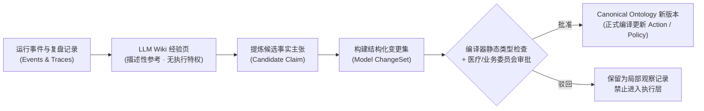

# `nashsu/llm_wiki` 与本体双向锚定

开源仓库：[`https://github.com/nashsu/llm_wiki`](https://github.com/nashsu/llm_wiki)

如果说 Karpathy 的 Gist 给出了 LLM Wiki 的思想蓝图，那么 **`nashsu/llm_wiki`** 就是把这一蓝图变成开箱即用产品的代表性开源实现。它不仅提供了跨平台桌面端与可视化图谱，还内置了多信号概念关联算法与 MCP Server 接口。

这一课我们一方面拆解 `nashsu/llm_wiki` 中值得复用的工程设计，另一方面解决一个至关重要的架构问题：**在 `llm-ontology` 驱动的智慧医院 SaaS 中，LLM Wiki 怎样与正式 Ontology 协同工作，同时又绝不越界篡改业务规则？**

::: tip 读完这一页你应该能回答
- `nashsu/llm_wiki` 是如何用 **本地 Markdown Vault + 多信号关联图算法 + MCP** 将 Karpathy 蓝图工程化的？
- 什么是 **Ontology 与 LLM Wiki 的双向语义锚定（Bidirectional Semantic Anchoring）**？
- 为什么当 Agent 处理新任务时，“先过 Ontology 找语义锚点，再顺着锚点检索 Wiki”远胜于对全院文档做全文向量搜索？
- 为什么必须立下铁律：**知识可以推动 Ontology 演化，但 Wiki 绝不能直接控制业务动作**？
:::

## 一、`nashsu/llm_wiki` 的四大工程亮点

`nashsu/llm_wiki` 采用 **Tauri (Rust 后端) + React (前端)** 构建了一个本地优先（Local-first）的持久知识编译系统，其核心工程设计包括：

### 1. 原生兼容 Obsidian 的 Markdown + `[[wikilinks]]` 存储
系统不把编译后的知识锁在私有二进制数据库里，而是直接输出为带有标准 YAML Frontmatter 和 `[[双向链接]]` 的 `.md` 文件夹。这意味着人类专家（如医务科主任、主任医师）可以直接用 Obsidian 或任何编辑器打开查看、批注和审阅 AI 编译出的知识库。

### 2. 多信号图关联分析（Multi-Signal Graph Relevance）
为了发现不同概念页面之间的深层联系，`nashsu/llm_wiki` 不单靠 Embedding 相似度，而是综合了四种图信号计算节点关联权重：
- **Source Overlap（原始资料重叠度）**：两个概念是否频繁共同出现在同一批 `raw/` 规章或病例复盘中；
- **Direct Wikilinks（显式双链引用）**：页面正文之间的直接引用；
- **Adamic-Adar Index（共同邻居拓扑指数）**：在知识图谱中共享稀缺中间节点的程度；
- **Type Affinity（类型亲和度）**：不同知识页类型（如“故障/并发症现象”与“处置方案”）之间的先验关联。

### 3. 自动化生命期维护（Import → Parse → Synthesize → Graph）
导入 PDF、EPUB、网页或 Office 文档后，后台自动完成解析、抽取核心概念、更新既有 Wiki 页面或创建新页，并实时刷新可视化关系图谱。

### 4. 原生 MCP Server 与 Agent Skills 暴露
内置本地 HTTP API 与 Model Context Protocol (MCP) Server，允许 Claude Code、Codex 或业务 Agent 直接调用工具查询、追加和巡检知识库。

---

## 二、核心架构设计：Ontology 与 LLM Wiki 的双向语义锚定

在 `llm-ontology` 系统中，我们既需要 **Canonical Ontology** 的铁面无私（保证状态机、权限、数据映射与指标口径 100% 确定性），又需要 **LLM Wiki** 的博闻强识（沉淀运行期长尾排障经验、科室协作技巧与案例复盘）。

连接两者的关键设计，就是 **基于稳定本体 ID 的双向语义锚定（Bidirectional Semantic Anchoring）**：

$$\boxed{\text{Canonical Ontology 提供稳定语义锚点 (Stable IDs)}} \longleftrightarrow \boxed{\text{LLM Wiki 提供可追溯的经验上下文}}$$

### 具体是怎么双向链接的？

以医院「患者出院协同」运行三个月后沉淀的一篇 Wiki 页面为例：

```markdown
---
id: wiki.cardio_friday_discharge_delay
title: 心内科周五下午出院带药与床位周转延迟排查经验
status: reviewed_by_head_nurse
ontology_anchors:
  entities:
    - hospital.encounter
    - hospital.discharge_pathway
    - hospital.take_home_medication
  actions:
    - hospital.action.pre_audit_meds
    - hospital.action.expedite_pending_lab
evidence_sources:
  - raw/traces/2026-10-trace-summary.jsonl
  - raw/retros/2026-q3-cardio-retro.pdf#frag_p4
---

## 历史运行观察
在过去 12 个周五的运行事件（`Domain Event`）统计中，心内科三病区 14:00 后才签发 `MedicallyFit` 的患者，其出院带药核对平均耗时达 **135 分钟**（平日为 45 分钟）。

## 关联排查建议（供出院协同 Agent 参考）
1. 当 `hospital.encounter` 处于周四晚间且临床评估恢复良好时，建议提醒主治医师提前评估是否可触发 `hospital.action.pre_audit_meds`（前置药房预审）。
2. 若合并超声复查待出（参见 [[超声科周末排班协同]]），应优先调用 `hospital.action.expedite_pending_lab`。
```

请注意上面 Frontmatter 中的 `ontology_anchors` 字段：
- 它引用的不是随随便便的自然语言词条，而是 **Canonical Ontology 中不可变的稳定节点 ID**（如 `hospital.discharge_pathway`、`hospital.action.pre_audit_meds`）。
- 反过来，在 `Canonical Ontology` 发布后生成的 **`Ontology Context Package`** 中，`hospital.discharge_pathway` 节点下也会挂接指向 `wiki.cardio_friday_discharge_delay` 的反向引用。

### 为什么这比全文向量检索可控十倍？

当出院协同 Agent 正在处理心内科一位患者的 `DischargePathway` 时：
1. 它首先通过 **Canonical Ontology** 明确知道当前对象是 `hospital.discharge_pathway`，当前状态是 `InTreatment`，时间是周四下午；
2. `Ontology Context Resolver` 直接顺着 `hospital.discharge_pathway` 的稳定 ID 锚点，精准拉取挂载在该概念下的 2 篇高相关度 Wiki 页面；
3. Agent 根本不需要去全院几万篇文档里盲目跑向量近似搜索，彻底消除了“把儿科门诊配药经验张冠李戴到心内科住院出院”的幻觉风险。

---

## 三、不可逾越的红线：为什么 Wiki 绝不能直接控制业务动作？

这是整个系统最容易被初学者破坏的安全边界。

假设某天 LLM Wiki 根据几次急诊抢救记录，自动综合生成了一段文字：

> *“经验总结：当病房急需用床而超声报告未出时，可以先在系统里把床位状态改为空闲，等患者做完检查再补录。”*

如果系统允许 Agent 把 Wiki 里的这段话直接当成可执行规则，就会酿成严重的医疗安全与院感事故（新患者被分到尚未终末消毒或前一位患者尚未离院的床位）。

因此在 `llm-ontology` 中，从 **LLM Wiki（经验）** 到 **Canonical Ontology（规则）** 必须经过一道严格的晋升闸门：



记住这句话：**Ontology 管业务定义与执行契约；LLM Wiki 管知识解释与经验复盘。知识可以推动 Ontology 演化，但知识本身绝不等于已经被批准的业务规则。**

## 下一课预告

我们已经弄清楚了 Ontology（第 1 章）、Auto-Ontology & Semantica（第 2 章）和 LLM Wiki（第 3 章）。但还有一个核心问题：**业务人员（如医务科主任、护士长）看不懂代码和 AST，而系统工程师和 Agent 又必须依赖严格的类型化模型——怎样让业务人员和工程师在同一个模型上无缝协作？** 下一课我们进入第四模块：**[JetBrains MPS 与投影式编辑：模型才是唯一事实源](/mps/projectional-editing)**。
